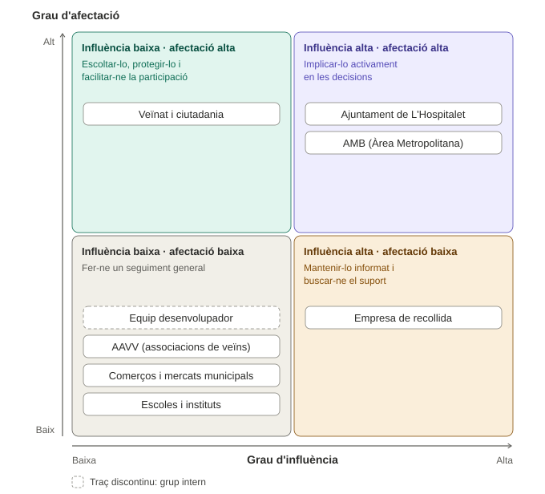

Membre 2: [Alejandro Josue Marquez Holguin] — Fet Part1 i Part2 
Membre 3: [Jesús Atset Moreno] — Fet Part3 i Part4 

**Repte:** Reduir els residus no reciclables i millorar la recollida selectiva als barris de L'Hospitalet de Llobregat.

## Part 1. Determinar els grups d'interès i classificar

Per dur a terme el projecte a L'Hospitalet, hem definit 8 grups d'interès clau. La classificació com a **Intern** o **Extern** la fem des de la perspectiva del nostre equip de treball de l'INS Provençana:

1. **Equip Desenvolupador (Alumnat INS Provençana):** **INTERN**  
   Som els encarregats de dissenyar, coordinar i plantejar les solucions al repte.
2. **Veïnat i Ciutadania de L'Hospitalet:** **EXTERN**  
   Són els que generen els residus a casa i qui finalment ha de separar bé la brossa en el dia a dia.
3. **Ajuntament de L'Hospitalet (Àrea de Serveis Urbans):** **EXTERN**  
   L'administració local que gestiona el servei de neteja, posa les regles i paga les penalitzacions si no es recicla.
4. **Empresa de recollida de residus (p. ex., FCC):** **EXTERN**  
   Executa la recollida, buida contenidors i fa el transport del material.
5. **Comerços de barri i Mercats Municipals:** **EXTERN**  
   Generen molta quantitat de cartró, plàstics i orgànica en horaris molt concrets.
6. **Associacions de Veïns (AAVV) i entitats locals:** **EXTERN**  
   Dinamitzen els barris i tenen connexió directa amb la gent del carrer.
7. **Àrea Metropolitana de Barcelona (AMB):** **EXTERN**  
   Entitat metropolitana que tracta la brossa als ecoparcs i cobra el canon de rebuig.
8. **Escoles i Instituts del municipi:** **EXTERN**  
   Punts clau per educar i conscienciar tant als joves com a les seves famílies.

---

## Part 2. Anàlisi dels Grups d'Interès

En aquesta taula analitzem en detall com afecta el problema a cada col·lectiu, què esperen, el seu nivell d'impacte i com poden ajudar a resoldre'l:

| Grup d'interès | Intern / Extern | Com li afecta el problema? | Què necessita o espera? | Grau d'afectació | Influència | Paper en la solució |
| :---           | :---            | :---                       | :---                    | :---:            | :---:      | :---                |
| **Equip Desenvolupador (INS Provençana)** | Intern | Necessitem trobar una solució viable i real per aprovar el mòdul i aportar valor al nostre entorn. | Dades de valor sobre residus, suport del centre i feedback real dels veïns per validar la proposta. | **Mitjà** | **Mitjana** | Dissenyar la proposta, analitzar les dades i coordinar la comunicació entre els diferents actors. |
| **Veïnat i Ciutadania de L'Hospitalet** | Extern | Pateix la brutícia al carrer, les olors i la falta d'espai als contenidors. Si no es recicla, els pot pujar la taxa de brossa. | Facilidades per reciclar, informació senzilla, contenidors nets a prop de casa i possiblement algun incentiu. | **Alt** | **Mitjana** | Canviar hàbits a la cuina, separar bé la brossa a origen i fer servir les eines o campanyes que es proposin. |
| **Ajuntament de L'Hospitalet** | Extern | Paga altes penalitzacions per portar tant rebuig a l'abocador i rep moltes queixes per incivisme. | Reduir costos de gestió, complir amb les lleis europees de reciclatge i tenir els carrers més nets. | **Alt** | **Alta** | Finançar o autoritzar el projecte, ajustar la ubicació o tipus de contenidors i fer complir les ordenances. |
| **Empresa de recollida de residus** | Extern | Trobar brossa barrejada (impropis) els dificulta la feina i fa que els processos de triatge siguin més cars i lents. | Que la brossa arribi ben triada des de casa per complir els seus objectius de contracte sense compliarse la logística. | **Mitjà** | **Alta** | Ajustar rutes o freqüències de buidat i compartir dades sobre quins punts de la ciutat acumulen més rebuig. |
| **Comerços i Mercats Municipals** | Extern | Generen un volum molt alt d'envasos i cartró que sovint col·lapsa els contenidors del veïnat. | Horaris i punts de recollida pensats per a la seva activitat, sense complicar-los la feina diària. | **Mitjà** | **Baixa** | Utilitzar canals específics de recollida comercial i fomentar la reducció d'envasos amb els seus clients. |
| **Associacions de Veïns (AAVV)** | Extern | Es veuen directament afectades per la degradació de la convivència i del barri quan hi ha brutícia acumulada. | Ser escoltades per l'Ajuntament i aconseguir millores visibles en la neteja dels seus carrers. | **Mitjà** | **Mitjana** | Ajudar a difondre la iniciativa, organitzar xerrades veïnals i donar-nos la seva opió sobre el que falla. |
| **Àrea Metropolitana de Barcelona (AMB)** | Extern | Si arriba molt rebuig no separable a les plantes de tractament, es col·lapsen els ecoparcs i augmenten els costos. | Que la ciutat augmenti el percentatge de recollida selectiva, sobretot d'orgànica i envasos. | **Alt** | **Alta** | Aportar dades tècniques, finançament per a campanyes públiques i assessorament en la gestió de residus. |
| **Escoles i Instituts** | Extern | Reben l'impacte de l'incivisme a l'entorn escolar i busquen eines per treballar la sostenibilitat a les aules. | Materials educatius pràctics i activitats motivadores per als seus estudiants. | **Baix** | **Baixa** | Sensibilitzar els joves perquè actuïn com a prescriptors de bon reciclatge a les seves pròpies cases. |

---

## Part 3. Matriu d'influència i afectació

El mapa queda dividit en quatre zones segons el **grau d'influència** (eix X, de baix a alt) i el **grau d'afectació** (eix Y, de baix a alt) de cada grup. Per passar dels tres nivells de la Part 2 (Alt / Mitjà / Baix) a dos, considerem «alt» només el que la taula marca com a Alt o Alta; Mitjà/Mitjana i Baix/Baixa es consideren «baix».

| Situació del grup | Estratègia recomanada | Grups d'interès |
| :--- | :--- | :--- |
| Influència alta i afectació alta | Implicar-lo activament en les decisions | Ajuntament de L'Hospitalet, AMB |
| Influència alta i afectació baixa | Mantenir-lo informat i buscar-ne el suport | Empresa de recollida de residus |
| Influència baixa i afectació alta | Escoltar-lo, protegir-lo i facilitar-ne la participació | Veïnat i Ciutadania |
| Influència baixa i afectació baixa | Fer-ne un seguiment general | Equip Desenvolupador (intern), AAVV, Comerços i Mercats, Escoles i Instituts |

## Part 4. Selecció dels grups més rellevants

A partir de la matriu, seleccionem els tres grups que necessiten una atenció prioritària: l'**Ajuntament de L'Hospitalet** i l'**Àrea Metropolitana de Barcelona (AMB)**, que són a la zona d'influència i afectació altes, i el **Veïnat i Ciutadania**, que és el grup més afectat i qui ha de canviar els hàbits al dia a dia. Aquesta selecció no vol dir que la resta de grups no siguin importants, sinó que identifica els actors que estan especialment afectats o que poden influir de manera decisiva en el projecte.

### 1. Ajuntament de L'Hospitalet (Àrea de Serveis Urbans)

1. **Com li afecta el problema:** paga penalitzacions elevades per portar tant rebuig a l'abocador i rep moltes queixes per incivisme.
2. **Necessitats i expectatives:** reduir els costos de gestió, complir les normatives europees de reciclatge i tenir els carrers més nets.
3. **Grau d'influència:** alt. Decideix el pressupost, la ubicació i el tipus de contenidors i fa complir les ordenances.
4. **Per què és important:** sense la seva autorització i finançament, la proposta no es pot portar a terme. A més, és qui més pot guanyar amb una reducció del rebuig.
5. **Com hauria de participar:** com a soci principal, implicat des del disseny. Cal presentar-li la proposta amb dades i càlcul d'estalvi, demanar-li autorització per fer una prova pilot en algun barri i mantenir-hi reunions de seguiment.

### 2. Àrea Metropolitana de Barcelona (AMB)

1. **Com li afecta el problema:** quan arriba molt rebuig que no es pot separar, els ecoparcs es col·lapsen i els costos de tractament augmenten. També cobra el cànon de rebuig.
2. **Necessitats i expectatives:** que la ciutat augmenti el percentatge de recollida selectiva, sobretot d'orgànica i envasos.
3. **Grau d'influència:** alt. Gestiona el tractament final dels residus i disposa de finançament i criteris tècnics.
4. **Per què és important:** té les dades tècniques i els recursos per donar suport a les campanyes, i el seu objectiu coincideix amb el del projecte.
5. **Com hauria de participar:** com a assessor i possible finançador. Cal demanar-li dades de qualitat de la recollida per barris, assessorament tècnic i suport per a les campanyes de sensibilització.

### 3. Veïnat i Ciutadania de L'Hospitalet

1. **Com li afecta el problema:** pateix la brutícia al carrer, les olors i la falta d'espai als contenidors. Si no es recicla, li pot pujar la taxa de brossa.
2. **Necessitats i expectatives:** facilitats per reciclar, informació senzilla, contenidors nets i a prop de casa i, possiblement, algun incentiu.
3. **Grau d'influència:** mitjà de manera individual, però decisiu en conjunt. El resultat depèn que separin bé la brossa a casa.
4. **Per què és important:** és el grup més afectat i el que ha de canviar els hàbits. Sense la seva participació, la millor solució tècnica no funciona.
5. **Com hauria de participar:** com a protagonista i no només com a destinatari. Cal escoltar-lo amb enquestes o converses als barris, validar-hi la proposta i comptar amb les AAVV per difondre-la i recollir-ne opinions.

